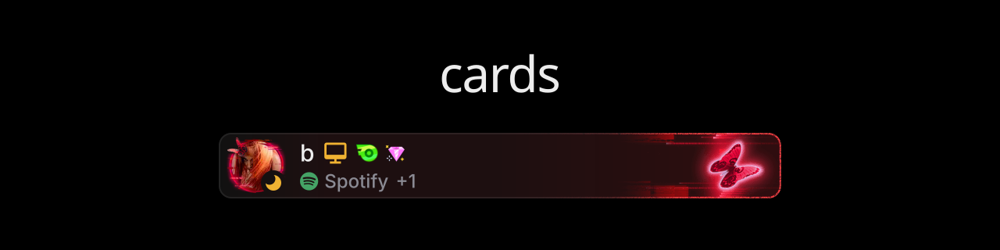
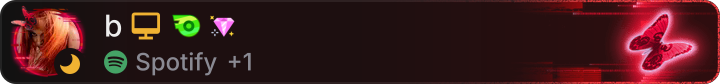

[](https://discord.bhoppi.ng)

<p align="center"><b>Live Discord presence for your README. One URL, no client, no tracking.</b></p>

<p align="center">
  <a href="https://github.com/prettylittlelies/cards"></a>
  <a href="https://github.com/prettylittlelies/cards/stargazers"></a>
  <br>
  <a href="https://bun.sh"></a>
  <a href="https://www.typescriptlang.org"></a>
  <a href="https://hono.dev"></a>
</p>

<p align="center">
  <a href="#usage">Usage</a> · <a href="#options">Options</a> · <a href="#how-it-works">How it works</a> · <a href="#self-hosting">Self-hosting</a>
</p>

---

## Usage

Join the [Lanyard](https://discord.gg/lanyard) server, build your card at **[discord.bhoppi.ng](https://discord.bhoppi.ng)** and paste the snippet:

```md

```



## Options

| Option | Values |
| --- | --- |
| Theme | dark · light |
| Font | gg sans · Poppins · system |
| Accent | nameplate colour, or any hex |
| Size | width 220–640 · scale 1–4× · radius 0–21 |
| Show | avatar · decoration · status · platforms · badges · activity · custom status · nameplate · surface |
| Motion | animated avatar · decoration · nameplate |

## How it works

- 🛰️ **Presence** comes from [Lanyard](https://github.com/Phineas/lanyard), cached for 10 seconds.
- 🏷️ **Badges and accent** come from [dstn.to](https://dcdn.dstn.to), cached for 12 hours on disk and served stale for up to 14 days.
- 🖼️ **Self-contained SVG.** Images and fonts are inlined, so the card renders through GitHub's image proxy.
- 🔐 **Tiny signed tokens.** Your config is a hand-rolled protobuf message signed with HMAC-SHA256. A typical token is about 35 characters.

## Self-hosting

Requires [Bun](https://bun.sh).

```sh
git clone https://github.com/prettylittlelies/cards
cd cards
bun install
bun run build
bun run serve
```

Set `CARDS_SECRET` to at least 32 random bytes, base64-encoded. Tokens only verify against the key that signed them.

`bun run assets` regenerates the banner and example card in `assets/`.
